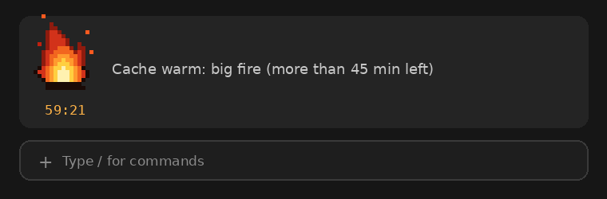
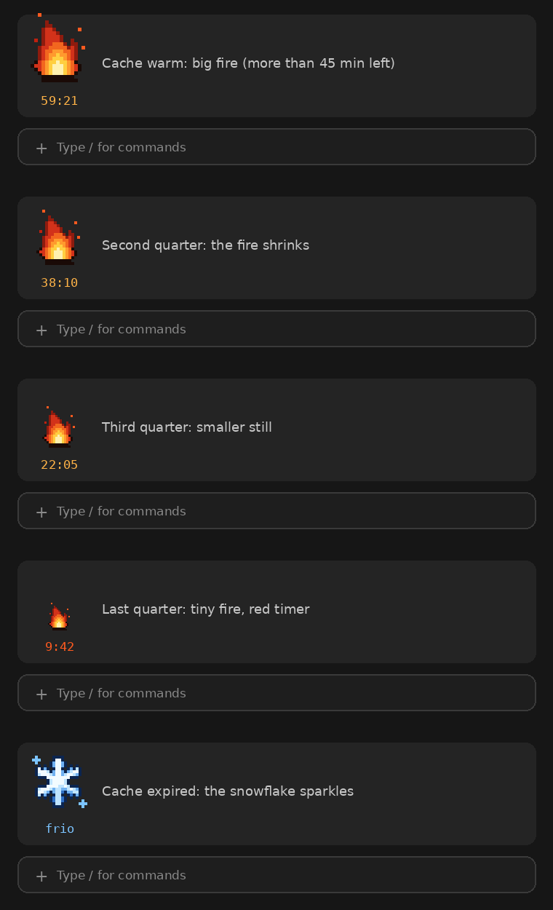

# warm-me

A Claude Code mod that tells you, at a glance, whether your session's **prompt cache is still warm**.

A pixel-art fire sits at the left of the band above the prompt. While the cache is warm it dances, with a countdown below it, and it gets smaller every quarter of the cache TTL. When the cache expires, the fire turns into a sparkling snowflake.



| Time left (1 h TTL) | What you see |
| --- | --- |
| more than 45 min | big fire |
| 30–45 min | medium fire |
| 15–30 min | small fire |
| 15 min or less | tiny fire, red timer |
| expired | snowflake, `frio` |

The countdown keeps running while a turn is open: a turn waiting on your answer to a question, or on a long tool call, sends no request and does not refresh the cache.



## Install

At the prompt of a Claude Code terminal session:

```
/plugin install warm-me --marketplace Mucida/warm-me
```

Answer `y` to add the marketplace, then choose a scope (user scope shows it in every project).

From a shell:

```bash
claude plugin install warm-me --marketplace Mucida/warm-me
```

## Usage

- `/warm-me` shows the TTL in use.
- `/warm-me 60` uses the 1 hour cache TTL (default).
- `/warm-me 5` uses the 5 minute TTL, for sessions that fall back to it (for example, when usage goes into overage).

The choice is saved across sessions.

## How it works

- It costs **no tokens**: the mod never calls the model. It only records the local time of each main-thread request (`turn.step`) and counts down from there.
- Each request reads or writes the prompt cache and refreshes its TTL, so "last request + TTL" is a close estimate. The API does not report the exact expiry, so it is an estimate, not a reading.
- Subagent requests are ignored: they have their own cache prefix and do not keep the main conversation warm.
- The sprites are SVG with SMIL animation, drawn as images (`hooks/sprites.ts`). Only the timer redraws once a second.
- On the terminal, which has no SVG, it shows 🔥 or ❄ with the timer.

## What it accesses

Hooks `session.start`, `command.run` (`/warm-me`), `turn.step` and `ui.render` (`AbovePrompt`). Calls `$.clock`, `$.state`, `$.store` (only its own TTL setting), `$.command.register` and `$.ui.resolve`. No files, processes or network.

## Development

```bash
claude plugin validate .
claude plugin test .
python3 -I tools/gen_sprites.py hooks/sprites.ts preview.png   # regenerate the sprites
python3 -I tools/mock.py docs                                   # regenerate the README images
```

The images in this README are mockups of the band, not screenshots.

## Em português

Mod do Claude Code que mostra se o cache de prompt da sessão ainda está quente: um foguinho em pixel art que diminui a cada quarto do TTL, com um timer, e vira um floco de gelo brilhando quando o cache esfria. Não gasta tokens. Use `/warm-me 5` ou `/warm-me 60` para escolher o TTL.

## License

MIT
